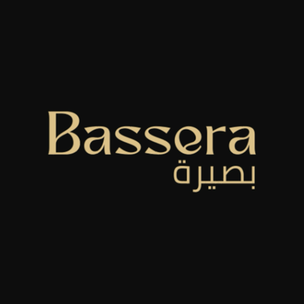
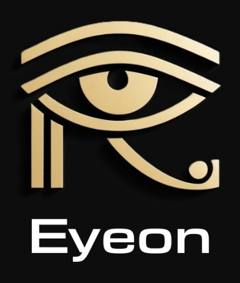

# بصيرة (Bassera)

التطبيق المصاحب لبندانة **Eyeon** لمساعدة المكفوفين وضعاف البصر: البندانة بتحس بالعوائق في 8 اتجاهات حوالين الراس وبتوصّل الاتجاه والمسافة بالاهتزاز، وبصيرة بتكمّلها.

**افتح التطبيق:** https://mohamedelazab1.github.io/bassera/

## فيه إيه
- توصيل بندانة Eyeon بالبلوتوث، ورادار حي للاتجاهات التمانية.
- إعدادات البندانة: الوضع (داخلي / شارع / زحمة)، قوة الاهتزاز، ومدى كل اتجاه.
- تدريب على لغة الاهتزاز: 4 دروس واختبار بيكرر الغلطات.
- "إيه اللي قدامي؟" وقراءة الكلام بكاميرا البندانة أو الموبايل، على الموبايل نفسه أو بـ Claude (اختياري).
- أوامر بالصوت بالعامية المصرية، واستغاثة بمكانك على واتساب أو SMS.
- **وضع تجريبي من غير أي جهاز** عشان تجرب كل حاجة.

## تشغيله
- **أندرويد:** افتح اللينك من Chrome، ومن القايمة اختار "إضافة إلى الشاشة الرئيسية".
- **آيفون:** Safari مش بيدعم بلوتوث الويب. افتح اللينك من تطبيق Bluefy.
- التطبيق صفحة ويب عادية (HTML و CSS و JavaScript) من غير build. الخط [Tajawal](fonts/OFL.txt) تحت رخصة SIL Open Font License.
